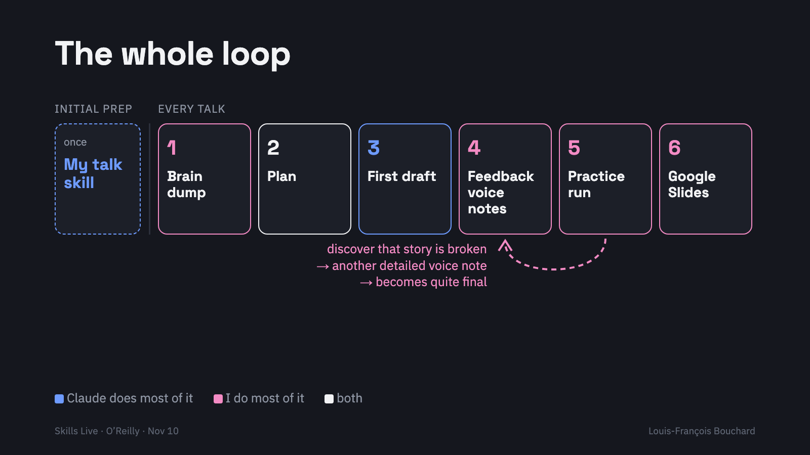

# Talk Decks skill

An agent skill for building talks with Claude Code, Codex or any agent that reads `SKILL.md` files. It gets you a decent first draft in a good presentation style, then follows **your** directions: plan first, voice-note feedback by slide number, timed practice runs, and a checked export to Google Slides or PowerPoint with build animations.

It is the general version of the skill [Louis-François Bouchard](https://www.louisbouchard.ai/) (Towards AI) uses for his own talks, shared with the O'Reilly Skills Live session **"How I build talks with Claude"** (Nov 10, 2026, with Lucas Soares).

## The loop



**Initial preparation (once):** a skill made of your own corrections. This repo is the starting point; [make-your-own.md](make-your-own.md) builds yours from your past threads.

Then, for every talk:

1. **Brain dump**, out loud, starting from what this room should leave able to do.
2. **Plan**: a one-liner per slide, iterated until the order works.
3. **First draft**, end to end, story first.
4. **Feedback voice notes**: one long dictated note per pass, by slide number, with the why.
5. **Practice run**, timed and out loud. The story breaks here; your next voice note fixes it. Repeat 4 and 5.
6. **Google Slides** (or PowerPoint) with build animations, fine-tuned by hand while you practice.

Claude does most of step 3 and the conversion in step 6. You do most of 1, 4, 5 and the final pass. The story is yours.

## Install

**Claude Code:** copy the `talk-decks/` folder to `~/.claude/skills/talk-decks/` (all your projects) or to `.claude/skills/talk-decks/` inside one project.

```bash
git clone https://github.com/louisfb01/talk-decks-skill.git
mkdir -p ~/.claude/skills && cp -r talk-decks-skill/talk-decks ~/.claude/skills/
```

**Codex and other agents:** put the `talk-decks/` folder wherever your agent loads skills from, or tell it to read `talk-decks/SKILL.md` before working on a deck.

Then ask for a talk: *"I'm giving a 15-minute talk on X to Y. Here's my brain dump: … Use the talk-decks skill and give me a plan first."*

## What's inside

```
talk-decks/
  SKILL.md                                   the loop, style rules, checks before sending
  FEEDBACK.md                                where your corrections accumulate
  references/preparation-and-rehearsal.md    planning, formats, rehearsal budget, recording reviews
make-your-own.md                             a prompt to build your version from your past threads
```

## Make it yours

The rules in `SKILL.md` came from one speaker's corrections. Yours will differ. Every time you correct the agent, it logs the correction in `FEEDBACK.md`; when you repeat one, it becomes a rule. After a few decks, the first draft already sounds like you.

## License

MIT. See [LICENSE](LICENSE).
